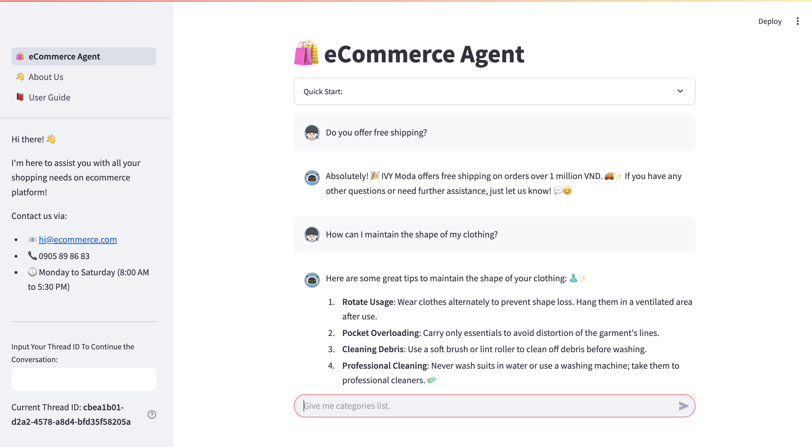

# 🛍️ Ecommerce Customer Support Agent

This repo is an implementation of a chatbot specifically focused on question answering over the Ecommerce website
Built with [LangChain](https://github.com/langchain-ai/langchain/), [LangGraph](https://github.com/langchain-ai/langgraph/), and [Streamlit](https://streamlit.io/).



## Prerequisites
- [uv](https://docs.astral.sh/uv/)
- [pre-commit](https://pre-commit.com/)
- [make](https://www.gnu.org/software/make/)

## 🔑 Tech Stack
- Python
- LangChain
- LangSmith
- LangGraph
- LangServe
- Streamlit.io
- Promptfoo
- OpenAI models:
  - Chat model: `gpt-4o-mini`
  - Embedding model: `text-embedding-3-small`

### Tech Stack Introduction
- Language
  - [Python](https://www.python.org/): Python is a programming language that lets you work quickly and integrate systems more effectively.
- Framework
  - [LangChain](https://langchain.com/): LangChain’s flexible abstractions and AI-first toolkit make it the #1 choice for developers when building with GenAI.
  - [LangSmith](https://www.langchain.com/langsmith): LangSmith is an all-in-one developer platform for every step of the LLM-powered application lifecycle, whether you’re building with LangChain or not. Debug, collaborate, test, and monitor your LLM applications.
  - [LangGraph](https://www.langchain.com/langgraph): Gain control with LangGraph to design agents that reliably handle complex tasks. Build and scale agentic applications with LangGraph Platform.
  - [LangServe](https://python.langchain.com/docs/langserve): LangServe helps developers deploy LangChain runnables and chains as a REST API. This library is integrated with FastAPI and uses pydantic for data validation.
- Library
  - [Streamlit.io](https://streamlit.io/): A faster way to build and share data apps. Streamlit turns data scripts into shareable web apps in minutes. All in pure Python. No front‑end experience required.
  - [Promptfoo](https://www.promptfoo.dev/): Test & secure your LLM apps
- Vector Store
  - [Chroma](https://docs.trychroma.com/): Chroma is the AI-native open-source vector database. Chroma makes it easy to build LLM apps by making knowledge, facts, and skills pluggable for LLMs.
    - [LangChain integrate with Chroma](https://python.langchain.com/docs/integrations/vectorstores/chroma/)


## 🛠️ Tools
- [uv](https://docs.astral.sh/uv/): Python package manager
- [pre-commit](https://pre-commit.com/): Git hooks
- [ruff](https://github.com/astral-sh/ruff): Python linter
- [langchain-cli](https://python.langchain.com/docs/langchain-cli/): LangChain CLI
- [remote-pdb](https://github.com/jupyter/remote-pdb): Remote debugger


## 📚 Setup
### ⬇️ Clone repo
- Clone repo with branch
  ```bash
  git clone https://github.com/thanhnguyen-agilityio/ecommerce-agent
  ```
- Access project folder
  ```bash
  ecommerce-agent
  ```

### 📦 Init environment
- Install dependencies: `uv sync`
- Access virtual environment: `source .venv/bin/activate`
- Create a `.env`: `cp .env.example .env` and fill require environment variables
  ```bash
  OPENAI_API_KEY=
  ...
  ```
- Load env: `make load_env`
  - or manual set environment:

    ```
    export OPENAI_API_KEY=
    ...
    ```

### 📚 Prepare data
(only needs to be done once)
- Run `make create_knowledge_base`

### ✅ Running app
- 🤖 Server App: `make run_server`
- 🎉 Client App: `make run_client`

## Authors
- Thanh Nguyen